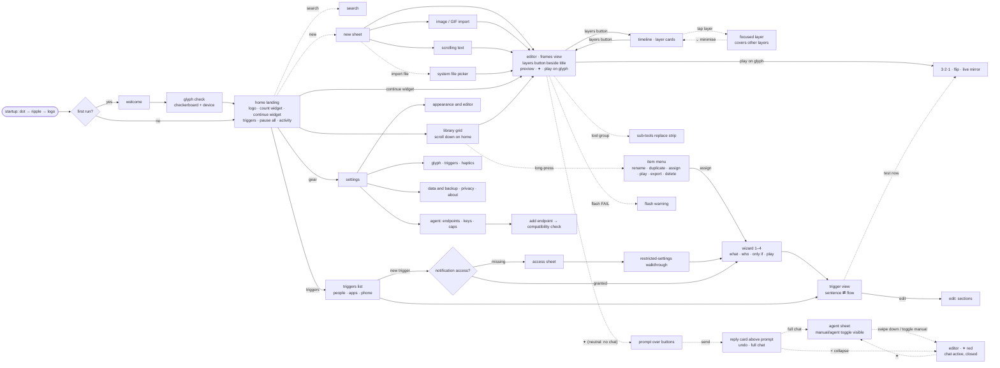

# GlyphWizard — App Flow (v1.1)

Updated 2026-10-12 after UI36–UI38. Solid arrows: push with parallax. Dotted arrows: sheet or overlay (blur-through).

**Changes since v1 (approved 35-flow-map):**
- Search is now an explicit path.
- The layers button toggles between the frames view and the timeline view.
- The timeline has a focused-layer state.
- The agent has explicit states: no chat (✦ neutral) → open (sheet + toggle) → active but closed (✦ red).
